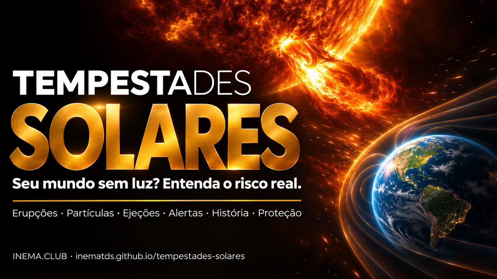

# Tempestades solares

**[Português](README.md) · [English](README.en.md) · [Español](README.es.md)**

## O que é

Vídeos educativos independentes do Nei sobre os fenômenos solares e seus efeitos na infraestrutura. Para quem quer interpretar alertas da NOAA, conhecer a história e preparar a família para falhas de serviço. Basta assistir ou ler. As chamadas são hipóteses educativas; não anunciam apagão mundial nem uma data.

## Assistir e baixar

- [Página com os vídeos e as explicações](https://inematds.github.io/tempestades-solares/guia/)
- [MP4 Full HD, legendas SRT e capas](https://github.com/inematds/tempestades-solares/releases/tag/videos-v1.1.0)
- [Manifesto com tamanho e SHA-256](videos/manifest.json)

Os vídeos são em português: impacto (1 min 42 s), leitura da NOAA (2 min 07 s) e história/proteção (8 min 11 s). Os dois primeiros têm formatos 16:9 e 9:16; o longo tem 16:9. Cada vídeo funciona sozinho.

## Conteúdo do repositório

- `conteudo/`: roteiros, fontes, créditos e verificações da produção.
- `assets/`: ilustrações, imagens de referência e capturas dos dashboards.
- `producao/`: scripts históricos, dependentes do ambiente INEMA.
- `guia/`: página de acesso em português, inglês e espanhol. Vídeos e capturas permanecem no idioma original.
- `videos/`: manifesto dos arquivos; os MP4 grandes ficam nos Releases.

## Fontes e reutilização

NOAA/SWPC, National Weather Service, USGS, NASA e SpaceWeatherLive. Os créditos completos estão em [FONTES-E-CREDITOS.txt](conteudo/FONTES-E-CREDITOS.txt). As mídias de terceiros mantêm suas próprias condições de uso. Não há autorização genérica implícita sobre todas as imagens. Conteúdo educativo gratuito: https://inema.club.

## O processo, do início ao fim

1. 🧠 Roteiro e chamada por vídeo: `conteudo/<slug>/ROTEIRO.md` e `chamada.json`.
2. ⚙️ Avatar do Nei pelo estúdio HeyGen, depois download, transcrição local (inemavox) e alinhamento: `producao/preparar.py` e `producao/montar.py`.
3. ⚙️ Biblioteca de ilustrações pelo Codex `image_gen` (assinatura): `producao/v3/pedido-imagens-*.txt`.
4. 🧠 Roteiro visual cena a cena, uma imagem por momento e troca a cada 2–4 s: `producao/v3/{equipamentos,noaa,historia}.py`.
5. ⚙️ Pastas v3 com o mesmo avatar: `python3 producao/v3/prep_v3.py <slug>`.
6. ⚙️ Build, check, render, som e QA: `python3 producao/v3/render_v3.py <config>` (explicavideos v2, perfil viral).
7. 🧠 Conferir as folhas de quadros: capa no quadro 0 sem legenda por cima, CTA em tela limpa.
8. ⚙️ Release no GitHub (`videos-v1.1.0`), `videos/manifest.json` e links no guia.
9. ⚙️ Lives10: `python3 producao/v3/trocar_lives10.py <i> <mp4> <srt>`. Sobe no mesmo horário e tira o antigo da agenda, sem apagar.
